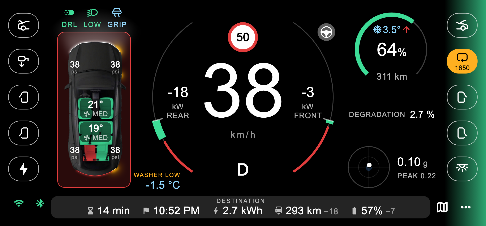
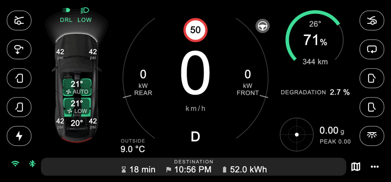
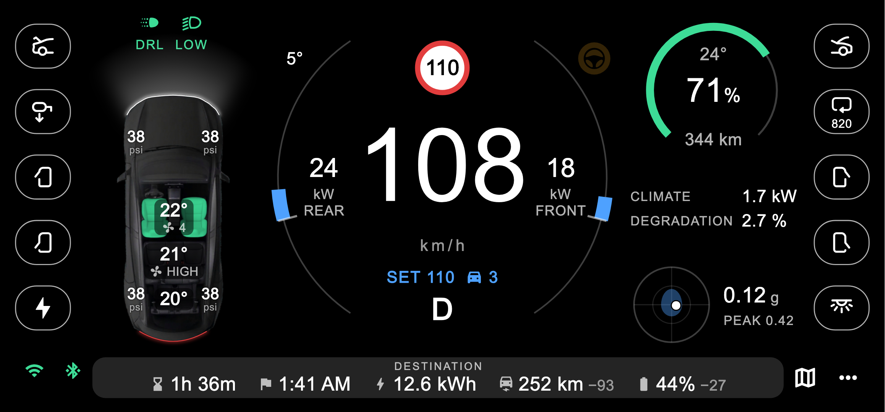
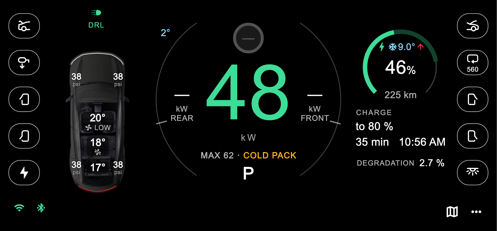
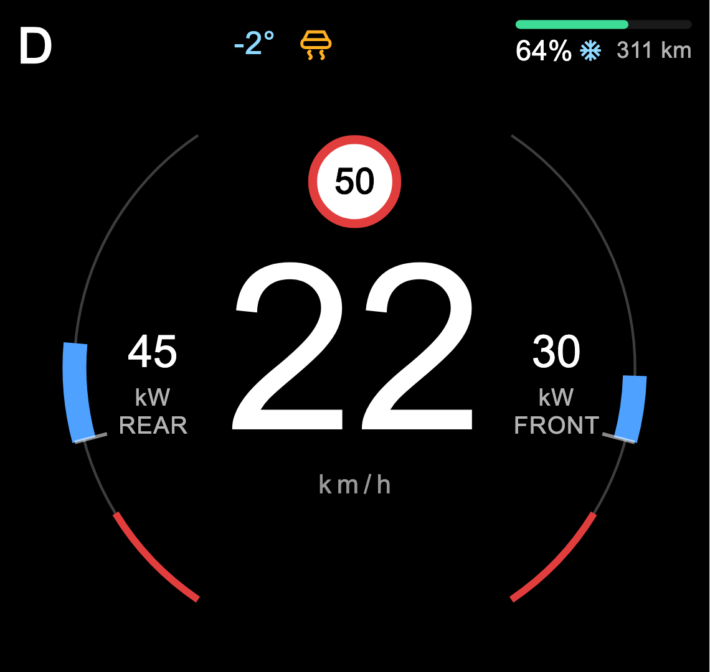

# Wattline

A landscape driver's display for a phone mounted behind the wheel of a
Tesla Model Y, fed by an Enhauto **S3XY Commander** or any Panda-protocol
OBD WiFi adapter ([without a Commander](#without-a-commander)). Built for the Model Y
Juniper (2025 on), 5 or 7 seats, rear- or all-wheel drive; tested on a
7-seater. Flutter; Android first, iOS works too.





It shows:

- speed in a ring, with front and rear motor power, and in red the regen
  a cold or full pack can't take; how hard the brake is pressed as a red line in
  the ring's foot (a rear-motor car: the right arc is the pedals instead,
  accelerator up, brake down);
- battery % and range in a small dial like the speed ring (a bolt while
  charging, the arc dim on to the charge limit), and the pedal as a line
  along the top that grows from the centre (not on a rear-motor car);
- the gear engaged under the speed, speed limit, autopilot state with the
  car's hands-on nag, and the cruise set speed and follow distance;
- turn signals, blind spot and brake as glows along the screen edges;
- the lights on (DRL, low, high), drawn on the car too (light bars front
  and rear, low and high beams as cones ahead, the tail brighter braking,
  the indicators in amber), and grip, each only while on: the car's
  slippery-road verdict and traction or stability control stepping in
  (both while moving), Slip Start left on;
- the outside temperature (ice blue near freezing), washer fluid low, cell
  imbalance and degradation; the pack's coldest cells and whether it is
  heating over the battery %;
- the route along the bottom: time to go and arrival time, the energy
  and range it uses, and battery and range at arrival (plus its length and
  the destination when the Commander has them);
- the car from above (a Model Y with 5 or 7 seats, as picked at the first
  launch): tyre pressures on the wheels, and on the seats each row's
  temperature, the front and second rows' fans (Auto's level
  when on Auto), buckled belts in green and a taken seat left unbuckled in
  red;
- a g-meter like Track Mode's: a dot for the force felt (up braking, down
  speeding up, right in a left turn), the g now and this drive's peak
  (WiFi only; across is the yaw rate times the speed);
- cabin CO₂, on the recirculation button;
- charging: the power going in, the most the pack takes now and why, and
  when it reaches the charge limit.

| On the motorway with Autopilot | Charging in the cold | Beside Google Maps |
|---|---|---|
|  |  |  |

The screenshots are demo data at the phone's own resolution, rendered by
`test/dash_shot_test.dart`: `DASH_SHOT=$PWD/docs/screenshots flutter test
test/dash_shot_test.dart` redraws them. The drive is `test/drive_video_test.dart`
(`DRIVE_VIDEO=<dir>` writes its frames), made into a GIF by
`swift tools/frames_to_gif.swift <dir> docs/screenshots/drive.gif 10 800 2`
(or an MP4 by `tools/frames_to_mp4.swift`).

Buttons down both sides act on the car through the Commander, each door
on its own side: trunk, mirror tilt and the charge port on the left,
frunk, recirculation and interior lights on the right. More actions
(locks, honk, flash, climate) are under ⋯.

**Basic layout** (picked at the first launch, or a switch in the settings):
the same ring, with bigger text in a stack of cards on each side, swiped up
or down. The cards are energy (battery, power use, pack health), drive
(lights and grip, Autopilot, g-meter, outside), the car, the buttons and
the route. Either side can show any card, and each side remembers its own.

## Where the data comes from

The Commander offers two links, and the app uses both:

| | WiFi (ScanMyTesla mode) | Bluetooth (EnhAPI) |
|---|---|---|
| What | raw CAN frames over UDP, decoded in the app | values the Commander pushes |
| Needs | ScanMyTesla support on, phone on `S3XY_OBD` | the phone approved once |
| Used for | every value it has | the buttons; data when WiFi is off |

WiFi comes first; Bluetooth carries the buttons and fills in for WiFi when
ScanMyTesla is off. While WiFi is live, Bluetooth asks only for what WiFi
lacks (the route and recirculation): in ScanMyTesla mode the Commander is
short of memory, so it is not asked for the same data twice. Bluetooth also
steps aside while the WiFi stream starts and joins once it runs: connected
before the stream started, the Commander went down. It also starts no link
while WiFi is mid-try (at start, when the app comes back, on every retry; on
Android a look for `S3XY_OBD`, up to 3 s by default and 1-10 s on the dialog's
scan-time slider, then the join and the hello):
connected first, it had the Commander switch its WiFi off. A link already
being made when a try begins is left to finish. A switch in the settings
(on by default) makes it wait for the live WiFi stream however long that takes, and WiFi
then looks for the network with no time limit; with ScanMyTesla off there
is then no Bluetooth either. Values neither link has are hidden.

What each setup is missing:

- **ScanMyTesla on (WiFi):** everything except the destination name and
  route distance. The Commander drops its own link to the car in this mode,
  and the S3XY Dash goes offline.
- **ScanMyTesla off (Bluetooth only):** tyre pressures, the seat map
  (belts, row temperatures and fans), grip, cabin CO₂, washer fluid, the cruise
  set speed, the charging figures, the charge port, mirror and
  interior-light states, and the CAN diagnostics. The destination and the
  route's length show only if the Commander is paired with the car as a
  key (S3XY app › Commander › Pair With The Car).

The Commander serves live data to one client at a time, and the S3XY Dash
never backs off, so the app does. When the Commander says the Dash is
connected, the app leaves Bluetooth to it: the Bluetooth icon turns grey.
A button press borrows the Commander, without its data, and hands it back
30 s after the last press. Bluetooth car data and the destination then stay
on the Dash; unplug the Dash to have them on the phone. With ScanMyTesla
off as well, the app has no gear then, so frunk, trunk and doors stay
locked out (they open in P only). The app asks for
the scroll-wheel approval only the first time, or when you tap.

### Without a Commander

The WiFi link is the plain Panda protocol (CAN frames over UDP), so any
OBD WiFi adapter that streams it should feed the dash: nearly everything
above comes from the car's own CAN frames, decoded in the app. Set the
adapter's WiFi name, password, address and port in the settings (the
Commander's are `S3XY_OBD`, `12345678`, `192.168.4.1`, `1338`). What only
the Commander gives: the buttons, the destination and the route's length,
and the recirculation state. Only tested with the Commander so far.

## Setup

1. In the S3XY app: Commander › Scan My Tesla, turn on **ScanMyTesla
   support** and **ScanMyTesla Always ON**. The Commander then raises the
   `S3XY_OBD` network (password `12345678`). Skip this step to run on
   Bluetooth only.
2. Open the dash. The first launch asks which car (Model Y, 5 or 7 seats,
   and a 5-seater's drive), then shows these steps, step 1 with the S3XY
   app's own screens, before the phone asks for its permissions.
   - Android joins `S3XY_OBD` itself (approve the system dialog once) and
     keeps mobile data for everything else.
   - On iPhone, join `S3XY_OBD` in Settings › Wi-Fi.
   - Changed the Commander's WiFi name or password in the S3XY app? Enter
     them with **Changed the WiFi name or password?** on the first-launch
     page (or later in the settings), before the first connection. A join
     that fails says so: "could not join ... wrong password?".
   - The WiFi and Bluetooth icons open the settings: the car, the network,
     host and port, the Android scan time and the Bluetooth timings.
3. Close the S3XY app: the Commander takes one Bluetooth client at a time.
   The first time, approve the phone in the car by double-pressing the
   right scroll wheel. A refused link waits for you rather than retrying
   (the Bluetooth icon stays orange): tap the icon to try again.
4. Optional, Android: the map button splits the screen with Google Maps,
   and the dash switches to a compact layout. Allow **Modify system
   settings** when asked: it keeps the split screen in landscape.

Diagnostics (the WiFi icon › Diagnostics) lists every CAN id seen, the decoded values
and the Bluetooth state. Its top bar shares the trace log, copies its end to the
clipboard, or clears it.

## Build

```sh
flutter analyze
flutter test
flutter build apk --release                                 # all ABIs
flutter build apk --release --target-platform android-arm64  # phones only, smaller
flutter build ios --simulator --debug
```

Every push to master builds the APKs on GitHub Actions
(`.github/workflows/apk.yml`), after analyze and the tests, and publishes
them as a pre-release (`build-N`); a version tag (`v1.0.0`) publishes a
full release. Each has `Wattline-Android.apk` for most phones (64-bit
ARM), `Wattline-Android-older-phones.apk` for any phone. The tests and
the two builds run side by side. Release builds are signed with the debug
key: store the Mac's
`~/.android/debug.keystore`, base64, as the `DEBUG_KEYSTORE` secret, and the
CI APK installs over a local build without losing the app's settings.

iOS needs Xcode as the selected developer directory, because native-asset
build hooks ignore `DEVELOPER_DIR`:

```sh
sudo xcode-select -s /Applications/Xcode.app/Contents/Developer
```

## Code

| File | What |
|---|---|
| `lib/main.dart` | the dash page: both links, settings, presses, the full and compact layouts |
| `lib/widgets.dart` | the pieces both layouts are built from: the ring's centre, the cards, the side buttons and the bottom bar (a part of main.dart) |
| `lib/panda.dart` | WiFi link and CAN decoding into live values |
| `lib/signals.dart` | CAN signal table (id, bits, scale), from the public Tesla DBCs |
| `lib/commander.dart` | Commander Bluetooth: protocomm Security1, EnhAPI actions and pushes |
| `lib/gauge.dart` | the power ring and the dash's colours |
| `lib/glyphs.dart` | the car's icons, as vector paths |
| `lib/car_panel.dart` | the ⋯ actions |
| `lib/diag.dart` | Diagnostics |

[docs/signals-and-actions.md](docs/signals-and-actions.md) maps every value
and action the dash does not have yet to its CAN signal or Commander
command, with recipes for wiring one up.

## Ground rules

- The app only listens on CAN; it never transmits there.
- Commander messages the app must not send: 84 (removes the Commander's car
  pairing), 132/134 (rewrites the Dash's record), and 86/88/90 outside a
  pairing the owner started.

## Credits

- CAN signal layouts and value tables: talas9's
  [tesla-can-signal-db](https://github.com/talas9/tesla-can-signal-db)
  (the 2026 Model Y DBCs behind the newer entries in `lib/signals.dart` and
  most of `docs/signals-and-actions.md`, ratings included), Josh Wardell's
  [model3dbc](https://github.com/joshwardell/model3dbc) (MIT),
  [onyx-m2-dbc](https://github.com/onyx-m2/onyx-m2-dbc) and dzid26's
  [opendbc](https://github.com/dzid26/opendbc), checked against captures
  from the car. One sample 0x347 frame in `test/obd_test.dart` is
  from [DashKit](https://github.com/softwiredtech/dashkit-firmware).
- The Commander's Bluetooth protocol follows
  [niklaswa/S3XYCommander](https://github.com/niklaswa/S3XYCommander) (MIT).

Unofficial: not affiliated with or endorsed by Tesla, Inc. or Enhauto.
Tesla and Model Y are trademarks of Tesla, Inc.; S3XY Commander, S3XY
Buttons and S3XY Dash are Enhauto products.

## Licence

Apache License 2.0, see [LICENSE](LICENSE).
